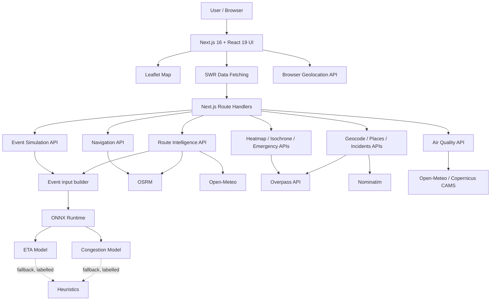

# RouteCast — Event Route Digital Twin & AI Traffic Simulator

> An AI-powered digital twin of Guntur City for event traffic: place a scheduled event on the map and RouteCast predicts, with trained ONNX models, how it slows the surrounding roads and which route to take.

[](https://nextjs.org/)
[](https://react.dev/)
[](https://www.typescriptlang.org/)
[](https://tailwindcss.com/)
[](https://leafletjs.com/)
[](https://www.openstreetmap.org/)
[](https://onnxruntime.ai/)

---

## Overview

**RouteCast** is a capstone/research prototype that simulates how a scheduled event loads a city's roads. Pick a route on a real map of Guntur, place one to three events (type, time window, expected attendance), and RouteCast predicts each route's travel time and congestion with and without the events, then recommends the least affected route.

The application has two experiences:

- **Event mode** — simulate events and see their route impact: per-route baseline vs event ETA, a per-road congestion heatmap, a reachable-area (isochrone) view, an emergency-access check, a what-if road closure, and a time slider that re-runs everything for any hour of the day.
- **Directions mode** — point-to-point routes from OSRM (OpenStreetMap data), scored with weather, incidents and closures.

Route ETA and congestion are predicted by two trained neural networks run through ONNX Runtime. If a model cannot be loaded the app falls back to a heuristic and **says so on screen**: every result carries its source (ONNX model, heuristic, OSRM free-flow, estimate).

> **Project status:** Functional research/capstone prototype.
> The models are trained on **synthetic** data from our own generator and have not been validated against observed Guntur traffic. Treat the output as a simulation, not a measurement or a live-traffic product.

---

## Purpose

RouteCast was built to show that event traffic can be planned for, not just reacted to, by combining:

- geospatial routing on real roads,
- trained ETA and congestion models,
- an event demand model (type, attendance, time window, distance from the venue),
- explicit provenance for every number,
- and interactive map visualization.

### Potential use cases

- event and venue access planning (festivals, matches, rallies),
- choosing a time slot or attendance level before committing,
- road-closure impact analysis near a venue,
- emergency-access checks through an event zone,
- urban mobility research and teaching.

It is **not** a certified emergency-routing, traffic-control or production dispatch system.

---

## Key Features

| Feature | Status | Description |
|---|---|---|
| Event simulation | Implemented | Event type, time window and attendance produce per-route baseline vs event ETA and congestion, using the ONNX models |
| Multiple events | Implemented | Up to 3 events combined; routes are scored against all of them (an extrapolation beyond single-event training, flagged in the response) |
| Traffic time slider | Implemented | Re-runs predictions for any hour; an event only loads the roads while it is running, peaking at its midpoint |
| Congestion heatmap | Implemented | Per-road congestion around each venue from the real Guntur OpenStreetMap road graph: event vehicles are routed from five city zones to the venue over directed roads and combined with the baseline using BPR travel times (Overpass estimate outside Guntur) |
| Offline fallbacks | Implemented | If OSRM, Nominatim or Overpass fail: one retry, then the local Guntur road graph (routes, free-flow) and landmark list (search, reverse geocode, hospitals/education/government/attractions/shopping). Responses are labelled |
| Reachability (isochrone) | Implemented | How far you can travel in a set time, with and without the event |
| Emergency access check | Implemented | Emergency route through the impact zone with a delay and recommendation |
| Organizer plan | Implemented | Staggered-arrival waves, diversion routes and marshalling points for an event, tested on the Guntur graph with before/after numbers from the same BPR model (`/api/event/plan`, Organizer Plan panel, map overlay) |
| Event re-route comparison | API | `/api/guntur` compares the normal free-flow route with the best route under an event's load on the Guntur graph |
| What-if closure | Implemented | Test a road closure and see whether it collides with the event's impact zone |
| Route metrics | Implemented | Selected-route speed, congestion, arrival and event delay (ONNX output once an event is simulated, OSRM free-flow otherwise); ambient AQI from Copernicus CAMS via Open-Meteo (does not react to events); CO₂ and fuel as labelled estimates; incidents from route intel. Every card shows its source |
| Directions routing | Implemented | Real OSRM routing for driving, walking and cycling, with alternatives and turn steps |
| Route intelligence | Implemented | Comparative 0–100 score from predicted congestion, incidents, weather and risk |
| Navigation session | Prototype | GPS tracking, progress, off-route detection, rerouting, follow-camera |
| Geocoding and POIs | Implemented | Nominatim search and reverse geocoding; Overpass nearby places |
| Model provenance | Implemented | Results are badged model or heuristic; approximated inputs are listed in the response note |
| ML training pipeline | Implemented | PyTorch training on a synthetic dataset and ONNX export (`ml/`) |
| Capstone presentation | Implemented | Browser deck at `/presentation` and a generated PowerPoint |
| Database | Not implemented | No persistent database |
| Authentication | Not implemented | No login or multi-user authorization |
| Live commercial traffic | Not implemented | Traffic is predicted/simulated rather than observed |

---

## How RouteCast Works

### Event Mode

1. Choose a route (A to B) on the map of Guntur.
2. Click **Place Event** and tap the map, or pick a known place, then set the event type, date, time window and expected attendance, and press **Simulate Traffic Impact**.
3. The server builds model inputs that reproduce the training-time feature formulas and predicts every route **twice** with the same models: normal traffic at the evaluated hour (baseline) and the same hour with the event's proximity, severity and load. The delay is the difference.
4. Routes are ranked by predicted event-time ETA and the least affected one is recommended.
5. Add up to two more events: congestion boosts add up per route, and only events that actually reach a route affect it.
6. Drag the **Traffic Time** slider to re-run the predictions for any hour. Before and after an event's window it contributes nothing.
7. Inspect the result in the route table, Impact Dashboard, congestion heatmap, isochrone, emergency and what-if panels.

How the event changes congestion for a route:

```text
congestion = base(hour, day) + Σ boost(event type) × reach(distance to venue) × phase(time)
```

`reach` is 1 at the venue and falls to 0 at the impact radius (200 m + 5.8 m × √attendance, capped at 1.5 km, the largest radius in the training data). `phase` is 0 outside the event window and 1 at its midpoint.

### Directions Mode

1. Search for an origin and destination or select coordinates on the map.
2. Nominatim converts text searches into geographic coordinates.
3. OSRM returns real route geometry, duration, distance, alternatives, and steps.
4. Routes are rendered through Leaflet.
5. The route-intelligence API enriches candidate routes with:
   - predicted traffic,
   - incidents,
   - weather,
   - ETA,
   - risk,
   - comparative score.
6. The user can start a navigation session.
7. RouteCast tracks progress and can reroute when off-route movement is detected.

---

## Architecture



---

## Technology Stack

| Technology | Version | Role |
|---|---:|---|
| Next.js | 16.3.0 | Full-stack framework, App Router, API routes |
| React | ^19 | UI rendering |
| React DOM | ^19 | Browser rendering |
| TypeScript | 5.7.3 | Type-safe application code |
| Tailwind CSS | 4.3.3 | Styling |
| PostCSS | ^8.5 | CSS processing |
| shadcn | ^4.8.0 | UI tooling |
| Base UI | ^1.5.0 | UI primitives |
| Lucide React | ^1.16.0 | Icons |
| Leaflet | ^1.9.4 | Interactive mapping |
| React Leaflet | ^5.0.0 | React bindings for Leaflet |
| SWR | ^2.5.0 | Client-side fetching and caching |
| ONNX Runtime Node | ^1.27.0 | Optional ML inference |
| Vercel Analytics | 1.6.1 | Production analytics |
| PptxGenJS | ^4.0.1 | PowerPoint deck generation |
| PyTorch | ML tooling | Optional model training |
| Python | 3.x | Optional ML training pipeline |
| pnpm | Recommended | Package management |

---

## External Services

### Nominatim

Used for:

- forward geocoding,
- reverse geocoding,
- nearby-place fallback.

Default:

```text
https://nominatim.openstreetmap.org
```

No API key is required for the current development configuration.

### OSRM

Used for:

- route geometry,
- route alternatives,
- route steps,
- distances,
- durations.

Default:

```text
https://router.project-osrm.org
```

No API key is required.

### Overpass API

Used for OpenStreetMap nearby-place discovery.

Default:

```text
https://overpass-api.de/api/interpreter
```

### Open-Meteo

Used for current weather enrichment along route corridors.

Default:

```text
https://api.open-meteo.com/v1/forecast
```

### Map Tiles

The project can use map layers from:

- OpenStreetMap,
- CARTO,
- Esri World Imagery.

> Public instances are convenient for development and demonstrations but are subject to provider terms, attribution rules, rate limits, and availability.

---

## Project Structure

```text
RouteCaste/
├── app/
│   ├── api/
│   │   ├── air-quality/route.ts
│   │   ├── emergency/route.ts
│   │   ├── event/plan/route.ts
│   │   ├── event/simulate/route.ts
│   │   ├── geocode/route.ts
│   │   ├── guntur/route.ts
│   │   ├── heatmap/route.ts
│   │   ├── incidents/route.ts
│   │   ├── intelligence/route/route.ts
│   │   ├── isochrone/route.ts
│   │   ├── navigation/route/route.ts
│   │   └── places/nearby/route.ts
│   ├── presentation/page.tsx
│   ├── globals.css
│   ├── layout.tsx
│   └── page.tsx
│
├── components/
│   ├── city-map.tsx
│   ├── emergency-panel.tsx
│   ├── event-scheduler-panel.tsx
│   ├── impact-dashboard.tsx
│   ├── isochrone-panel.tsx
│   ├── layer-controls.tsx
│   ├── location-search.tsx
│   ├── metrics-dashboard.tsx
│   ├── organizer-plan-panel.tsx
│   ├── nav-hud.tsx
│   ├── navigation-panel.tsx
│   ├── poi-panel.tsx
│   ├── route-intel-panel.tsx
│   ├── time-slider.tsx
│   ├── whatif-panel.tsx
│   └── presentation/
│       ├── slide-deck.tsx
│       └── slides.tsx
│
├── hooks/
│   ├── use-geolocation.ts
│   ├── use-nav-session.ts
│   ├── use-navigation-route.ts
│   └── use-route-intel.ts
│
├── lib/
│   ├── air-quality.ts          # ambient AQI client (Open-Meteo / CAMS)
│   ├── event-model-inputs.ts   # training-compatible model inputs, event phase, multi-event
│   ├── guntur-graph.ts         # Guntur OSM road graph: demand routing, BPR, offline routes
│   ├── guntur-plan.ts          # organizer plan: waves, diversions, marshalling points
│   ├── guntur.ts               # service layer for /api/guntur
│   ├── guntur-places.ts
│   ├── ml.ts                   # ONNX loading and inference
│   ├── ml-contracts.ts         # model input contracts
│   ├── route-metrics.ts        # per-route metrics with source tags
│   ├── types.ts
│   ├── geo/ (geocoder, places, routing, offline fallbacks)
│   ├── intel/ (incidents, score, weather)
│   └── nav/progress.ts
│
├── ml/                          # PyTorch training pipeline (data, schema, train)
├── models/                      # eta.onnx, congestion.onnx, metrics.json
├── tests/                       # Vitest: ML, event inputs, route metrics, Guntur graph, fallbacks
├── data/processed/              # Guntur roads, nodes, zones, events (OpenStreetMap-derived)
├── scripts/                     # dataset generation and deck generator
├── docs/                        # model card, dataset methodology
├── public/RouteCast-Capstone-Deck.pptx
├── .env.example
├── next.config.mjs
├── package.json
└── tsconfig.json
```

---

## API Reference

### `GET /api/geocode`

Forward geocoding.

Example:

```text
/api/geocode?q=Vijayawada&limit=5
```

Returns matching places with:

- name,
- address,
- latitude,
- longitude,
- place type.

The same endpoint also supports reverse-geocoding parameters using latitude and longitude.

---

### `POST /api/event/simulate`

Simulates one or more events and scores routes against them.

```json
{
  "events": [
    { "name": "Sankranthi Festival", "type": "festival", "lat": 16.3067, "lng": 80.4365,
      "locationName": "Guntur Bus Stand", "startTime": "2026-11-20T17:00:00",
      "endTime": "2026-11-20T21:00:00", "attendance": 5000 }
  ],
  "routes": [
    { "id": "r1", "label": "Route 1", "distanceMeters": 5000, "durationSeconds": 600,
      "samplePoints": [{ "lat": 16.29, "lng": 80.43 }] }
  ],
  "hourOverride": 18.5
}
```

- `events` takes 1 to 3 events (a single `event` object is also accepted). `routes` and `hourOverride` are optional; `hourOverride` is a decimal hour of day that evaluates each event at its phase at that hour.
- Event types: `festival`, `sports`, `concert`, `protest`, `construction`, `vip_visit`, `public_gathering`, `other`.
- The response has `event` and `events`, per-route `baseEtaMin`, `eventEtaMin`, `etaDeltaMin`, `congestionBefore`, `congestionDuring`, `congestionClass`, `affectedBy` and `recommended`, a parametric `forecast`, a `hotspot`, an `evaluation` (hour and event phase), and `source`.
- `source` is `"model"` only if every prediction for every route came from an ONNX model; otherwise `"heuristic"`. The `note` lists approximated inputs and, for several events, that the combination is an extrapolation.

### `POST /api/heatmap`

Per-road congestion segments around an event. Body: `lat`, `lng`, `impactRadiusMeters`, `eventLoad`, optional `attendance`, `eventPhase` (0..1) and `hourOverride`.

With `attendance` and a venue inside Guntur, segments come from the local road graph (`source: "guntur-graph"`): zone demand is routed to the venue over directed roads, added to the hour-of-day baseline, and congestion is volume/capacity. Otherwise it falls back to an Overpass-based estimate (`source: "overpass-estimate"`).

### `POST /api/isochrone`

Reachable area from an origin within `timeLimitMinutes` (1 to 30), optionally reduced by an event (`eventLat`, `eventLng`, `eventLoad`).

### `POST /api/emergency`

Emergency route from an origin to a destination, with its delay and a pre-positioning recommendation when an event is supplied.

### `POST /api/event/plan`

Body: `lat`, `lng`, `attendance`, `startTime` (ISO). Returns `plan`: `options` (1 to 4 arrival waves with peak vehicles, overloaded roads and lost vehicle-hours), `recommendedWaves` and its reason, `diversions` (per city zone, with geometry), `marshalPoints` (about 1.2 km before the venue on each approach), `before` / `wavesOnly` / `after` metrics and `assumptions`. Evaluated at the busiest arrival hour (one hour before the start) within 2.5 km of the venue. Diversions are timed under the staggered load and kept only if re-running the model shows they cut total delay. Returns 422 outside the Guntur graph.

### `GET /api/guntur`

Dataset status, events and zones. With `route=1&eventId=..&timestamp=ISO&fromLat=..&fromLon=..&toLat=..&toLon=..` it returns the normal free-flow route and the best route under that event's load at that time, both timed with the same BPR model (`normal`, `rerouted`, `savedSec`, `samePath`). Both points must be within 1.5 km of the graph.

### Fallback labels

`/api/navigation/route` and `/api/intelligence/route` return `degraded` (null normally) when live routing failed and the offline Guntur route was used. `/api/geocode` and `/api/places/nearby` return `source: "local-guntur"` when answered from the local landmark list.

### `GET /api/air-quality?lat=..&lng=..`

Ambient US AQI from the Copernicus CAMS model via Open-Meteo. Returns `{ "aqi": null }` when the feed is unavailable. Regional background data; it does not react to simulated events.

---

### `POST /api/navigation/route`

Creates real point-to-point routes using OSRM.

Example body:

```json
{
  "origin": {
    "lat": 16.5062,
    "lon": 80.6480
  },
  "destination": {
    "lat": 16.3067,
    "lon": 80.4365
  },
  "waypoints": [],
  "mode": "driving",
  "alternatives": true
}
```

Returns:

- route engine,
- travel mode,
- route alternatives,
- distance,
- duration,
- geometry,
- navigation steps,
- estimated-duration indicators.

---

### `POST /api/intelligence/route`

Enriches routes with intelligence and scenario analysis.

Example:

```json
{
  "origin": {
    "lat": 16.5062,
    "lon": 80.6480
  },
  "destination": {
    "lat": 16.3067,
    "lon": 80.4365
  },
  "waypoints": [],
  "mode": "driving",
  "scenario": {
    "type": "closure",
    "intensity": 0.6,
    "at": {
      "lat": 16.42,
      "lon": 80.55
    }
  }
}
```

Supported scenario types:

```text
none
closure
accident
traffic
rain
flood
```

Response intelligence may include:

- route alternatives,
- baseline and scenario intelligence,
- weather,
- incidents,
- predicted traffic,
- ETA,
- route score,
- recommendation,
- model availability,
- detour information.

---

### `GET /api/incidents`

Returns current in-memory incidents.

Optional filters:

```text
lat
lon
radius
```

---

### `POST /api/incidents`

Creates an incident.

Example:

```json
{
  "type": "accident",
  "lat": 16.45,
  "lon": 80.60,
  "severity": "high",
  "radiusMeters": 500,
  "description": "Lane blocked"
}
```

Supported incident types:

- accident,
- closure,
- construction,
- flooding,
- obstruction,
- emergency,
- weather.

> Incident data is process-local and is lost when the server restarts.

---

### `DELETE /api/incidents`

Examples:

```text
/api/incidents?id=<incident-id>
```

or

```text
/api/incidents?simulated=1
```

---

### `GET /api/places/nearby`

Returns nearby OpenStreetMap POIs.

Typical parameters:

```text
category
lat
lon
radius
limit
```

Primary provider: Overpass API  
Fallback provider: Nominatim

Supported categories include:

- restaurants,
- hotels,
- hospitals,
- universities,
- airports,
- fuel stations,
- EV charging,
- banks,
- ATMs,
- pharmacies,
- police,
- fire stations,
- parking,
- shopping,
- attractions,
- government facilities.

---

## Route Intelligence

RouteCast uses comparative route scoring rather than treating the routing engine's first result as automatically optimal.

### Congestion

Baseline congestion is estimated using time-of-day behavior and may be adjusted using:

- weekday/weekend patterns,
- incidents,
- traffic-surge scenarios,
- weather,
- optional ONNX congestion prediction.

Incident severity weights:

```text
low      = 0.20
medium   = 0.45
high     = 0.70
critical = 1.00
```

Closures, flooding, and critical incidents may mark routes as blocked.

### ETA

Heuristic ETA is based on:

```text
base ETA
× (1 + traffic × 0.85)
× (1 + weather impact × 0.22)
+ incident delay
```

### Risk

Risk combines:

```text
incident risk × 0.45
+ weather impact × 0.30
+ traffic level × 0.15
+ area density × 0.10
+ blockage penalty
```

### Comparative Score

RouteCast produces a normalized 0–100 route score based on relative candidate-route performance:

```text
1
- time penalty × 0.45
- risk score × 0.30
- traffic level × 0.18
- weather impact × 0.07
```

Blocked routes are heavily penalized.

The highest-scoring route becomes the recommendation.

> Traffic and ETA values are predicted or simulated unless a real external provider/model explicitly supplies them.

---

## Machine Learning

RouteCast ships two trained models in `models/`:

```text
models/eta.onnx          (+ eta.onnx.data)
models/congestion.onnx   (+ congestion.onnx.data)
```

If a model file is missing or inference fails, RouteCast falls back to deterministic heuristics and labels the result `heuristic`.

### ETA Model

Nine features (see `ml/schema.py`): distance, current travel time (log), current congestion, normalized speed, hour sine and cosine, event proximity, scenario severity and event load. The output is the log of the ratio of future to current travel time, decoded as `currentTravelTime × exp(output)`.

### Congestion Model

Nine features: current congestion, forecast step, normalized speed, road capacity, hour sine and cosine, incident load, scenario severity and event proximity. Five classes: free, light, moderate, heavy, severe.

### Tensor contract

```text
Input name:  input
Input type:  float32
Input shape: [batch, 9]

Output name: output
```

### Reported metrics (held-out synthetic data)

| Model | Metric | Value |
|---|---|---:|
| ETA | R² | 0.942 |
| Congestion | Exact accuracy | 0.800 |
| Congestion | Within one class | ~1.000 |
| Congestion | Macro-F1 | 0.806 |

These are measured on held-out data from our own synthetic generator (`scripts/generate_synthetic_dataset.py`), not on observed traffic. They show the networks learned the simulator.

### How inputs are built

`lib/event-model-inputs.ts` reproduces the training-time feature formulas (for example the congestion feature is 0.85 × c², and event proximity and load follow `ml/data.py`). Two inputs are approximated for OSRM routes, which carry no road-level data: current congestion comes from the training data's hour-of-day profile, and road capacity uses the training mean. The API response lists them.

### Training Pipeline

The `ml/` directory contains a PyTorch workflow that trains feed-forward MLPs on the synthetic dataset and exports ONNX:

```text
models/eta.onnx
models/congestion.onnx
models/metrics.json
```

The project should be described as a **proof of concept**, not a validated traffic predictor: the training data is synthetic and has not been calibrated against observed Guntur traffic.

---

## Scenario Simulation

### Event Mode

The event simulator (see *How RouteCast Works*) compares each route under normal traffic against the same hour with the event running. Events do not slow routes that they do not reach, and an event only contributes while it is running.

### Real-Route Intelligence

Supported scenarios:

- road closure,
- accident,
- traffic surge,
- heavy rain,
- flood.

For blockage scenarios, RouteCast can request genuine OSRM detours using offset waypoints. The detour geometry is generated by the real routing engine, while the incident/blockage itself remains simulated. Scores in this mode are heuristic by design, because the models were not trained on closure or flood scenarios.

---

## Environment Variables

Create `.env.local` from `.env.example`.

| Variable | Required | Default / Example | Purpose |
|---|---|---|---|
| `GEOCODING_URL` | Optional | `https://nominatim.openstreetmap.org` | Geocoder endpoint |
| `GEO_USER_AGENT` | Recommended | `RouteCast/1.0 (capstone digital twin)` | Nominatim identification |
| `ROUTING_URL` | Optional | `https://router.project-osrm.org` | Routing engine |
| `ETA_MODEL_PATH` | Optional | `models/eta.onnx` | ETA ONNX model |
| `CONGESTION_MODEL_PATH` | Optional | `models/congestion.onnx` | Congestion ONNX model |
| `OVERPASS_URL` | Optional | `https://overpass-api.de/api/interpreter` | POI provider |
| `WEATHER_API_URL` | Optional | `https://api.open-meteo.com/v1/forecast` | Weather provider |

Windows CMD:

```cmd
copy .env.example .env.local
```

PowerShell:

```powershell
Copy-Item .env.example .env.local
```

Linux/macOS:

```bash
cp .env.example .env.local
```

---

## Installation

### Prerequisites

Recommended:

- Node.js 20+
- pnpm
- modern browser
- internet connection
- browser geolocation permission for GPS features

Optional:

- Python 3.x for model training
- native runtime compatibility for `onnxruntime-node`

### Clone the Repository

```bash
git clone https://github.com/Dark-Matter007/RouteCaste.git
cd RouteCaste
```

### Install Dependencies

Recommended:

```bash
pnpm install
```

Or with npm:

```bash
npm install
```

### Configure Environment

```cmd
copy .env.example .env.local
```

### Run Development Server

```bash
pnpm dev
```

or:

```bash
npm run dev
```

Then open the local URL printed by Next.js, normally:

```text
http://localhost:3000
```

---

## Available Commands

Using pnpm:

```bash
pnpm dev
pnpm build
pnpm start
pnpm lint
```

Using npm:

```bash
npm run dev
npm run build
npm run start
npm run lint
```

There is currently no dedicated automated test script in `package.json`.

---

## Optional ML Training

Windows PowerShell example:

```powershell
cd ml
python -m venv .venv
.venv\Scripts\Activate.ps1
pip install -r requirements.txt
python train.py
```

The training pipeline is expected to create model artifacts under:

```text
models/
```

The Next.js backend searches for the default files:

```text
models/eta.onnx
models/congestion.onnx
```

or paths supplied through environment variables.

---

## How to Use

### Find a Location

Use the location search box and choose a Nominatim result.

RouteCast can use that coordinate to:

- center the map,
- relocate the event-mode synthetic graph,
- define route points,
- search nearby POIs.

### Create Real Directions

1. Switch to **Directions Mode**.
2. Select an origin.
3. Select a destination.
4. Choose:
   - driving,
   - walking,
   - cycling.
5. Add optional waypoints.
6. Generate routes.
7. Select an alternative.
8. Inspect route steps and intelligence.

### Compare Routes

Route intelligence can compare:

- predicted ETA,
- traffic level,
- weather impact,
- incidents,
- risk,
- AI/comparative score.

### Start Navigation

1. Choose a route.
2. Start navigation.
3. Grant browser location permission.
4. RouteCast tracks your position and route progress.
5. Off-route movement can trigger rerouting.

Manual map interaction can also be used for demonstrations when GPS is unavailable.

### Simulate an Event

1. Pick an origin and destination to get routes.
2. Click **Place Event**, tap the map (or choose a place), then set the type, time window and attendance and press **Simulate Traffic Impact**.
3. Read the route table and Impact Dashboard: baseline vs event ETA, congestion class and delay per route, with the recommended route starred.
4. Add up to two more events to see them combine, and remove one with the × on its chip.
5. Drag the **Traffic Time** slider to see the same events at another hour.
6. Use the heatmap, isochrone, emergency and what-if panels to inspect the impact zone.

### Explore Nearby POIs

Choose categories such as:

- hospital,
- police,
- fuel,
- EV charging,
- parking,
- restaurant,
- hotel.

POIs can be inspected and used as route stops or destinations.

## Advantages

- Uses an open geospatial stack; no commercial mapping API key is needed.
- Predicts event impact with trained models and compares like with like (same model for baseline and event).
- Labels every result with its source, and falls back to heuristics without breaking when a model is unavailable.
- Handles several overlapping events and any time of day.
- Combines event simulation with real-world routing, weather and incident context.
- Has unit tests for the feature encoders, decoders, event-input builder and route metrics.
- Can be self-hosted as a Next.js application.

---

## Current Limitations

- The ETA and congestion models are trained on **synthetic** data and are not validated against observed Guntur traffic.
- For OSRM routes, current congestion and road capacity are approximated (listed in each response).
- The models were trained on single events; combining several events is an extrapolation.
- Directions-mode scoring (closures, accidents, floods) is heuristic.
- The congestion forecast curve and hotspot in the event response are parametric, not model output.
- CO₂ and fuel are fixed per-km estimates scaled by congestion.
- The offline route fallback is free-flow on the local Guntur graph, covers Guntur only and has no turn-by-turn maneuvers; the landmark fallback is a short curated list.
- The organizer plan covers one event (the strongest) and Guntur venues only; marshalling points are suggested positions, not surveyed sites.
- Isochrone, emergency and what-if checks take one event (the one loading the roads most at the chosen time) when several are simulated.
- No live commercial traffic feed.
- Incidents are stored only in process memory.
- No database or PostGIS integration.
- No authentication or user accounts.
- Public Nominatim, OSRM, Overpass and tile providers may rate-limit requests.
- Browser geolocation requires user permission.
- Public OSRM walking/cycling support may be limited.
- Automated tests cover the ML encoders/decoders, event-input builder and route metrics; there are no end-to-end or UI tests.
- No application-level rate limiting is implemented.
- Native `onnxruntime-node` deployment may require environment-specific handling.

---

## Security & Privacy Considerations

Current positive design choices:

- configuration is managed through environment variables,
- `.env.example` contains configuration examples rather than secrets,
- geocoding/routing requests are proxied through application API routes,
- browser geolocation depends on user permission.

Before production use, the project should add:

- authentication,
- authorization,
- incident API protection,
- request schema validation,
- rate limiting,
- persistent audit logs,
- secure headers,
- provider quota monitoring,
- location-data privacy policies,
- durable secure storage.

---

## Performance & Scalability

Event simulation runs two small MLP inferences per route per request, so the compute cost is negligible; latency is dominated by the public routing, Overpass and weather APIs.

Potential bottlenecks include:

- public API latency,
- Overpass query performance,
- repeated weather/routing requests,
- large Leaflet overlay counts,
- process-local state across multiple server instances.

For larger-scale production use, consider:

- Redis/server-side response caching,
- PostgreSQL + PostGIS,
- self-hosted OSRM/Nominatim/Overpass,
- shared incident storage,
- WebSocket or SSE updates,
- dedicated ML model serving,
- observability and provider monitoring.

---

## Deployment

### Vercel

The standard Next.js UI and API routes are compatible with Vercel.

Potential concerns:

- `onnxruntime-node` native runtime compatibility,
- model-file packaging,
- filesystem paths,
- public provider rate limits,
- process-local incident state,
- serverless execution limits.

### Traditional Node.js Server

A Node.js server is a strong fit for the current architecture because it supports:

- Next.js server execution,
- persistent ONNX sessions during process lifetime,
- native Node dependencies,
- predictable filesystem model paths.

### Docker

The project can be containerized using:

- Node.js base image,
- pnpm install,
- `next build`,
- `next start`,
- optional model files,
- environment-based provider configuration.

Python model training is better treated as a separate training workflow/container.

---

## Presentation System

RouteCast includes a capstone presentation system.

Browser presentation:

```text
/presentation
```

Relevant files:

```text
app/presentation/page.tsx
components/presentation/slide-deck.tsx
components/presentation/slides.tsx
```

PowerPoint generation:

```text
scripts/generate-deck.mjs
```

Generated deck:

```text
public/RouteCast-Capstone-Deck.pptx
```

The presentation covers the problem, the event-simulation method, architecture, the ML models and their (synthetic-data) metrics, reliability and honesty, the technology stack, limits and future work.

---

## Recommended Future Work

### Short Term

- Add automated unit and API tests.
- Enable strict TypeScript build validation.
- Add request validation.
- Add rate limiting.
- Add persistent incident storage.
- Improve provider loading/error states.
- Add route-intelligence export.
- Add map legends and clearer data provenance.

### Medium Term

- Integrate a live traffic provider.
- Add real incident/event feeds.
- Add authentication and user workspaces.
- Add WebSocket/SSE real-time updates.
- Store historical routes and simulations.
- Train ML models with real traffic data.
- Add model versioning and drift monitoring.
- Self-host OSRM, Nominatim, and Overpass.
- Add multi-modal transit routing.
- Add fleet/delivery optimization.

### Long Term

- Add PostgreSQL/PostGIS city data.
- Build richer 3D city/terrain visualization.
- Add voice navigation.
- Create mobile applications.
- Support emergency-priority routing.
- Add city-scale graph partitioning.
- Add IoT/sensor integration.
- Add predictive mobility-demand forecasting.
- Add privacy-preserving location analytics.

---

## Skills Demonstrated

RouteCast demonstrates experience with:

- full-stack Next.js development,
- React architecture,
- TypeScript,
- REST API design,
- browser APIs,
- OpenStreetMap ecosystem,
- geocoding,
- routing,
- route geometry,
- traffic modelling and event-demand simulation,
- geospatial distance calculations,
- spatial incident matching,
- scenario simulation,
- route scoring,
- SWR data fetching,
- Leaflet,
- ONNX Runtime,
- PyTorch,
- synthetic ML training data,
- responsive dashboard design,
- technical presentation generation.

---

## Screenshots Recommended for This README

For a stronger GitHub presentation, add screenshots of:

1. Main RouteCast map/dashboard
2. Directions mode with route alternatives
3. Route intelligence panel
4. Event simulation with the Impact Dashboard and Traffic Time slider
5. Congestion heatmap and route metrics
6. Presentation page

Suggested folder:

```text
public/readme/
```

Then embed them in this README, for example:

```markdown

```

---

## GitHub Topics

Recommended repository topics:

```text
nextjs
react
typescript
tailwindcss
leaflet
openstreetmap
nominatim
osrm
overpass-api
geospatial
geospatial-analysis
route-optimization
route-intelligence
traffic-simulation
digital-twin
smart-city
machine-learning
onnx
pytorch
threejs
react-three-fiber
navigation
weather-api
```

---

## Project Status

**Functional research/capstone prototype**

RouteCast is more than a static UI demo because it includes:

- working Next.js APIs,
- trained ONNX models running live in the event simulator,
- real geocoding, route generation and weather enrichment,
- navigation-session logic and rerouting,
- multi-event simulation with a time slider,
- unit tests for the ML input/output code.

It should not yet be described as production-ready because it does not currently include:

- authentication,
- durable persistence,
- live traffic,
- models validated against observed traffic,
- rate limiting,
- end-to-end testing,
- shared multi-instance state,
- full production observability.

---

## Guntur dataset-driven event routing

RouteCast now includes a connected Guntur, Andhra Pradesh pipeline. It downloads a real directed OpenStreetMap drive graph, exports source-preserving roads/nodes, creates clearly labelled modeled baseline traffic, assigns event vehicles over real graph paths, computes BPR dynamic edge weights, and exposes normal/event-aware Dijkstra, A*, and bidirectional comparisons at `/api/guntur` and in the dashboard's **Guntur event routing** panel. The original 8×8 graph is still available as a fallback/demo mode.

```powershell
python scripts/build_guntur_dataset.py
python scripts/train_traffic_model.py
python -m unittest discover -s tests -v
pnpm dev
```

At runtime the app does not need the pre-built per-timestamp shards: `lib/guntur-graph.ts` loads `guntur_roads.csv`, `guntur_nodes.csv` and `zones.csv` and computes event traffic on demand with the same BPR rule.

See [the methodology](docs/GUNTUR_DATASET_METHODOLOGY.md), [model card](docs/MODEL_CARD.md), and [runbook](docs/GUNTUR_PIPELINE_RUNBOOK.md). **All baseline, event-demand, and travel-time values are modeled—not measured Guntur road-sensor data.** OSM geometry/identifiers retain OpenStreetMap attribution and ODbL obligations.

---

## Repository

```text
https://github.com/Dark-Matter007/RouteCaste
```

---

## Disclaimer

RouteCast combines real external geospatial services with simulated and predicted intelligence.

Real services include routing, geocoding, weather, map tiles, and POI discovery. Event-mode traffic, some city metrics, scenarios, and default predictive outputs are deterministic or heuristic unless an optional ONNX model is available.

The application is intended for education, research, capstone demonstration, and prototyping. It should not be relied upon as a certified navigation, emergency-response, traffic-control, or safety-critical system.
